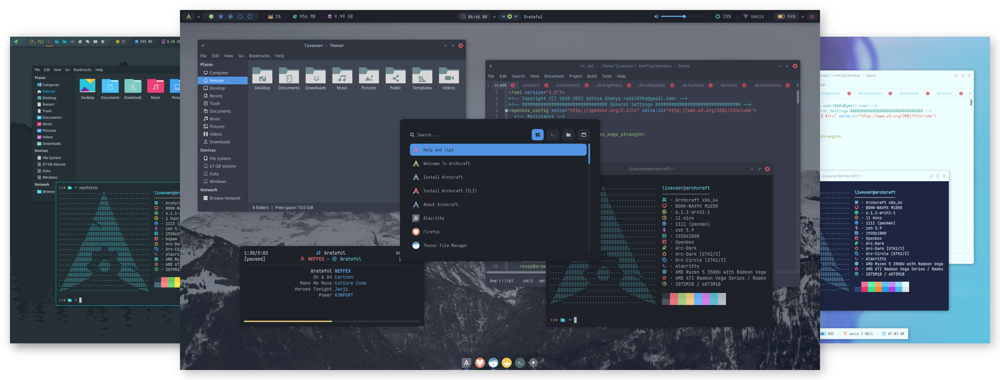

 <!--
  Archcraft | GitHub Organization Profile
  A thoughtfully crafted Linux desktop experience.
-->

  

<h2 align="center">Archcraft</h2>

<h4 align="center">A thoughtfully crafted Linux desktop experience, based on <a href="https://archlinux.org">Arch Linux</a>.</h4>

  
  
  
  
  
  
  
  

  

---

### About Archcraft

Archcraft is a minimal, Arch Linux-based rolling-release distribution built around lightweight window managers, carefully crafted configurations, and a refined desktop experience.

Designed with simplicity, performance, and customization in mind, Archcraft brings together a collection of thoughtfully selected applications, system tools, themes, and desktop configurations to provide a functional and visually cohesive environment right out of the box.

But Archcraft is more than just a Linux distribution.

It's an evolving ecosystem of desktop experiences, configurations, utilities, and resources built around the idea that a Linux desktop should be lightweight, practical, customizable, and enjoyable to use.

### The Desktop Experience

Archcraft takes a different approach to the traditional desktop environment.

Rather than relying on heavyweight desktop environments, the standard installation provides three carefully configured desktop experiences:

- **Openbox** — A lightweight stacking window manager offering a traditional desktop experience with flexible window placement, intuitive menus, and extensive customization.
- **Bspwm** — A dynamic tiling window manager built around efficient window organization, keyboard-driven controls, and highly customizable workflows.
- **Sway** — A Wayland-native tiling compositor with an i3-compatible workflow, bringing familiar keyboard-driven window management to a modern Wayland desktop.

Each comes with carefully integrated applications, custom themes, keybindings, scripts, and utilities, providing a complete desktop experience without unnecessary overhead.

The goal isn't simply to make Linux look different. It's to create an environment where every component has a purpose.

### More Than the Default Installation

Archcraft extends beyond its standard ISO through a growing collection of desktop configurations, tools, and additional experiences.

**Window Managers & Wayland Compositors**

Explore different approaches to desktop computing through preconfigured environments and configurations for various window managers and Wayland compositors, including:

- **Window Managers:** Openbox, Bspwm, i3, Qtile, Dwm, and many others.
- **Wayland Compositors:** Sway, Wayfire, River, Hyprland, Niri, MangoWM, Labwc, NEWM, and others.

These configurations bring together the window manager or compositor, application integrations, themes, utilities, scripts, and carefully organized configuration files to create cohesive desktop experiences.

**Tools & Utilities**

I develop and maintain a collection of tools and scripts designed to make everyday desktop tasks easier. From application launchers and system menus to wallpaper management, theme switching, media controls, and system integrations, these utilities help tie the desktop experience together.

**Customization & Themes**

Customization is an important part of Archcraft. Themes, color schemes, icons, fonts, wallpapers, and application configurations work together to provide a consistent desktop appearance while leaving room for personal preferences.

### Editions & Exclusive Experiences

In addition to the standard distribution, Archcraft offers specialized editions and exclusive desktop experiences.

- **Archcraft Prime** — A consolidated edition bringing together multiple window managers and Wayland compositors in a single installation.
- **Archcraft WSE** — A Wayland-focused edition featuring a collection of preconfigured Wayland compositors.

These editions, along with additional configurations and resources, are available through [Archcraft Premium](https://archcraft.io/premium.html).

### Documentation & Resources

I maintain documentation and resources to help users explore, understand, configure, and extend their desktop environments.

- **[Documentation](https://wiki.archcraft.io)** — Installation guides, configuration references, keybindings, customization, and troubleshooting.
- **[Gallery](https://gallery.archcraft.io)** — Screenshots and visual showcases of Archcraft desktop experiences.
- **[Website](https://archcraft.io)** — Downloads, project information, releases, and additional resources.
- **[GitHub](https://github.com/archcraft-os)** — Source code, packages, scripts, and development repositories.

### My Philosophy

I believe a good desktop experience should be built around three principles:

- **Functionality** — Every component should serve a purpose and contribute to the overall experience.
- **Usability** — Workflows should be intuitive, efficient, and practical for everyday computing.
- **Aesthetics** — Thoughtful design and visual consistency should complement functionality, not compete with it.

I bring these principles together to create desktop experiences that are lightweight, capable, and enjoyable to use.

### Community & Contributions

Archcraft is built for Linux enthusiasts who appreciate minimalism, customization, and the freedom to shape their computing environment.

Whether you're exploring Archcraft, sharing your customizations, reporting issues, suggesting improvements, or helping other users, you're welcome to be part of the community.

If you encounter an issue or have an idea for improvement, feel free to participate through my [GitHub repositories](https://github.com/archcraft-os) and community channels.

### Support Archcraft

I independently develop and maintain Archcraft. Its continued development, maintenance, testing, and infrastructure rely on the time and resources I invest in the project.

If you find Archcraft useful and appreciate the work behind it, consider supporting its development.

  
  

  Built with care for the Linux community.

